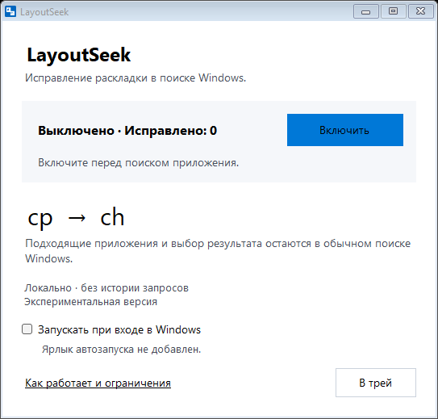
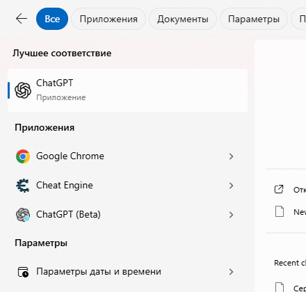

# LayoutSeek

[Русский](README.md)

Keyboard layout correction for app names in Windows Search. Type in the search box on the taskbar or open Start and begin typing. LayoutSeek checks installed app names and can correct a query such as `сркщьу` to `chrome`, without an extra keyboard shortcut.

**0.3.4 is a preview for Windows 11 24H2, x64.** It requires .NET Framework 4.8 or later. The interface is in Russian.



## Download and run

1. Download the portable ZIP from the [v0.3.4 preview release](https://github.com/alekzmasai/LayoutSeek/releases/tag/v0.3.4).
2. Extract it to a folder you want to keep. Keep `SearchLayout.exe`, `SearchLayout.exe.config`, `SearchNative.dll` and `StartupLauncher.exe` together.
3. Run `SearchLayout.exe`. A fresh manual launch starts with correction off.
4. Click **«Включить»** to enable correction, then use Windows Search as usual.

No installer or administrator privileges are required. The executables are unsigned, so Windows SmartScreen may show a warning.

## How it works

LayoutSeek maps characters by physical keyboard position and checks the result against a local list of installed apps. A match can start with a short prefix, such as `ср` → `ch`, and you can continue typing in the original layout. Continued input can restore the original text, as in the tested Russian words `срочно` and `среда`.



Native Search results captured during 0.3.3 verification of `ср` → `ch`. This is a previous-version example; 0.3.4 uses the same Search engine.

It waits for a pause in input. The idle delay is 700 ms; a correction commonly takes about a second, but timing varies. Results still come from native Windows Search.

Processing stays on your computer. LayoutSeek does not use keyboard hooks or process injection, keep a query history, or send queries over the network. Windows Search has its own network and history settings. See [Privacy](PRIVACY.en.md).

## Tray, startup and removal

**«В трей»** hides the window and keeps the current correction state. Launching the EXE again shows the same running instance. The window's close button and **«Завершить»** in the tray menu exit the app.

Startup is optional. Check **«Запускать при входе в Windows»** to add `LayoutSeek.lnk` to your Windows user Startup folder. The checkbox reports this app's shortcut registration; Windows can separately disable it in Startup settings. The shortcut selects startup mode, which opens in the tray and enables correction after the app list loads. An actual Windows sign-out and sign-in has not yet been tested.

Before moving the app folder, turn startup off, exit, move the folder, then enable startup from the new location. To remove LayoutSeek, turn startup off, exit and delete the extracted folder.

## Known limits

- Russian ↔ English US has been tested in native Search on one Windows 11 Enterprise LTSC 24H2 PC. Other standard layouts paired with English have synthetic test coverage only. IMEs, dead keys, composed input and ambiguous mappings are skipped.
- Valid Russian continuations were tested in specific scenarios; arbitrary text and every app name are not guaranteed to be recognized.
- This corrects keyboard layout mistakes in app searches. It is not translation, transliteration or search-index repair.
- An early 0.3.1 test recorded a missing first character before correction. The cause remains unexplained; later passing tests do not establish loss-free input.
- Compatibility with other Windows builds and behavior after an actual sign-in remain unverified.

<details>
<summary>Verification and building from source</summary>

Version 0.3.4 passed 127 UI checks with substituted dependencies, 12 shortcut checks using real Windows COM, and 10 checks through UI Automation on the running app. The live checks created and removed the current user's startup shortcut. They do not cover an actual Windows sign-in.

The Search engine is unchanged from 0.3.3. Native checks on that version passed 22 Search checks, 10 focus checks and 6 extra checks. One paste test was skipped because the test did not support the existing clipboard format. The layout module passed 37 checks including synthetic cases; that does not establish native support for every layout.

To build, use Windows x64 with the installed .NET Framework C# compiler, Visual Studio 2022 C++ build tools and a Windows SDK that includes C++/WinRT UI Automation headers. Open PowerShell in the repository root:

```powershell
.\Build.ps1
```

Output is written to `bin`. The default build includes test executables; it does not run them. To omit test builds:

```powershell
.\Build.ps1 -SkipTests
```

To build a portable release ZIP and SHA-256 checksums in `artifacts`:

```powershell
.\BuildRelease.ps1
```

Live Search tests control the real Search window and type test queries. Run them only on a free PC while nobody is using its keyboard or mouse.

</details>

## Support and license

Report a problem in [GitHub Issues](https://github.com/alekzmasai/LayoutSeek/issues), or email [ag@idbi.ru](mailto:ag@idbi.ru). Include your Windows version, keyboard layouts and steps to reproduce. GitHub Issues are public.

[MIT license](LICENSE). Copyright (c) 2026 t00r.
